# Actividad 5 — Formación e implementación de un modelo con Amazon SageMaker

**Ximena Sanchez Martinez** — Universidad de La Salle
AWS Academy — Módulo 3: Implementación de una canalización de aprendizaje automático con Amazon SageMaker

**Rama de trabajo:** `dev_xsanchez90`

## Introducción

Este documento reúne la evidencia y la explicación de los dos laboratorios de la Actividad 5, realizados sobre
instancias de cuaderno de Amazon SageMaker aprovisionadas por AWS Academy:

1. **Laboratorio 3.4 — Amazon SageMaker: formación de un modelo** ([`3_4-machinelearning.ipynb`](3_4-machinelearning.ipynb))
2. **Laboratorio 3.5 — Amazon SageMaker: implementación de un modelo** ([`3_5-machinelearning_es.ipynb`](3_5-machinelearning_es.ipynb))

Los dos laboratorios forman un solo flujo: en el 3.4 se preparan los datos y se entrena un clasificador
XGBoost; en el 3.5 ese modelo se aloja en un punto de enlace (endpoint), se usa para predecir y se evalúa por
lotes sobre el conjunto de prueba. Al final se responde la validación pedida en la actividad.

El escenario de ambos laboratorios es el mismo: un proveedor de atención médica quiere mejorar la detección de
anomalías en pacientes ortopédicos. El conjunto de datos (columna vertebral, Repositorio de Machine Learning de
la UCI) tiene 310 pacientes con seis características biomecánicas, en este orden:

| # | Característica | Columna |
|---|---|---|
| 1 | Incidencia pélvica | `pelvic_incidence` |
| 2 | Inclinación pélvica | `pelvic_tilt` |
| 3 | Ángulo de lordosis lumbar | `lumbar_lordosis_angle` |
| 4 | Inclinación del sacro | `sacral_slope` |
| 5 | Radio pélvico | `pelvic_radius` |
| 6 | Grado de espondilolistesis | `degree_spondylolisthesis` |

El objetivo (`class`) es **Anormal** (210 pacientes) o **Normal** (100 pacientes).

---

## Laboratorio 3.4 — Formación de un modelo

**Objetivos del laboratorio (según la guía):**

- Dividir los datos en tres conjuntos: entrenamiento, validación y prueba.
- Entrenar un modelo XGBoost con Amazon SageMaker.

### Paso 0 — Entorno de trabajo

**Qué hice:** inicié el laboratorio en AWS Academy, entré a la consola de Amazon SageMaker AI, abrí JupyterLab
en la instancia de cuaderno del laboratorio y abrí el cuaderno `es_es/3_4-machinelearning.ipynb` con el kernel
`conda_python3`. Agregué mi nombre al inicio del cuaderno.

**Por qué:** la instancia de cuaderno es el equipo donde corre el código; los recursos pesados (entrenamiento)
no corren en ella, sino en instancias que SageMaker levanta aparte y apaga al terminar.

### Paso 1 — Importación y exploración de los datos

**Qué hice:** ejecuté las celdas que descargan el `.zip` del conjunto de datos, leen el archivo
`column_2C_weka.arff` con `scipy.io.arff` y lo convierten en un DataFrame de pandas. Luego convertí la clase a
número con `class_mapper = {b'Abnormal': 1, b'Normal': 0}` y revisé la forma (`df.shape` → `(310, 7)`) y las
columnas (`df.columns`).

**Por qué:** XGBoost solo trabaja con números, así que la etiqueta de texto tiene que pasar a 0/1. Dejar
**Anormal = 1** hace que el modelo devuelva directamente la probabilidad de que el paciente sea anormal.

**Problema resuelto:** el kernel no traía `scipy` (`ModuleNotFoundError: No module named 'scipy'`), lo que
también produjo `NameError` en las celdas siguientes (`arff` y `df` no existían). Lo resolví con
`%pip install scipy scikit-learn` (scikit-learn se usa más adelante para dividir los datos), reinicié el kernel y
volví a ejecutar las celdas en orden. El aviso de `pip` sobre la versión de `cloudpickle` no afecta el
laboratorio.

### Paso 2 — Preparación: columna objetivo y división de los datos

**Qué hice:**

1. Moví la columna `class` a la primera posición (`cols = cols[-1:] + cols[:-1]`).
2. Dividí los datos con `train_test_split` de scikit-learn: primero 80 % entrenamiento y 20 % para prueba y
   validación; después ese 20 % en dos mitades iguales. En ambas divisiones usé `stratify=...['class']` y
   `random_state=42`.
3. Verifiqué los tamaños y la distribución de clases:

| Conjunto | Filas | Anormal (1) | Normal (0) |
|---|---|---|---|
| Entrenamiento | 248 | 168 | 80 |
| Prueba | 31 | 21 | 10 |
| Validación | 31 | 21 | 10 |

**Por qué:**

- El algoritmo XGBoost integrado de SageMaker exige que el archivo de entrenamiento tenga **la etiqueta en la
  primera columna**.
- **Entrenamiento** sirve para aprender; **validación** se usa durante el entrenamiento para medir el modelo con
  datos que no está aprendiendo; **prueba** se guarda para evaluar al final con datos que el modelo nunca vio
  (se usa en el laboratorio 3.5).
- `stratify` mantiene la misma proporción de anormales y normales (≈ 2:1) en los tres conjuntos, importante
  porque hay pocos datos. `random_state=42` hace que la división sea repetible.

**Problemas resueltos:** un `NameError: name 'train_test_split' is not defined` por ejecutar la segunda división
antes que la celda que importa la función (se corrigió ejecutando las celdas en orden), y un
`SyntaxError: unmatched ']'` por un corchete de más al escribir `print(test['class'].value_counts())`.

**Observación:** en este cuaderno la celda que mueve la columna objetivo quedó ejecutada **dos veces** al
reejecutar celdas, por eso la salida de `df.columns` muestra `degree_spondylolisthesis` en primer lugar y `class`
en segundo. Esa celda no se puede repetir sin volver a cargar los datos, porque cada ejecución rota las columnas
una posición más. En el laboratorio 3.5 la preparación se ejecuta una sola vez y el modelo que se despliega y
valida usa `class` como objetivo.

### Paso 3 — Carga de los datos a Amazon S3

**Qué hice:** definí el bucket del laboratorio, el prefijo `lab3` y los nombres de archivo, y usé la función
`upload_s3_csv` para subir los tres conjuntos (`vertebral_train.csv`, `vertebral_test.csv`,
`vertebral_validate.csv`) a las carpetas `train/`, `test/` y `validate/` del bucket.

**Por qué:** los trabajos de entrenamiento de SageMaker leen los datos desde S3, no desde el cuaderno. La función
escribe cada DataFrame en un búfer en memoria (`io.StringIO`), sin crear archivos locales, con `header=False` e
`index=False` porque el XGBoost integrado espera un CSV **sin encabezados y sin índice**.

### Paso 4 — Configuración y entrenamiento del modelo

**Qué hice:**

1. Obtuve el contenedor de XGBoost con `retrieve('xgboost', región, '1.0-1')`.
2. Definí los hiperparámetros:
   - `num_round: 42` → número de rondas de *boosting* (árboles que se construyen).
   - `eval_metric: auc` → métrica con la que se evalúa el conjunto de validación (área bajo la curva ROC).
   - `objective: binary:logistic` → clasificación binaria; la salida es una probabilidad entre 0 y 1.
3. Creé el `Estimator` con el rol de ejecución del laboratorio (`get_execution_role()`), **una** instancia
   `ml.m4.xlarge` y la ruta de salida `s3://<bucket>/lab3/output/`.
4. Definí dos canales de entrada `TrainingInput` con `content_type='text/csv'`: `train` y `validation`.
5. Ejecuté `xgb_model.fit(inputs=data_channels, logs=False)`.

**Por qué:** `retrieve` evita instalar XGBoost a mano: se usa el algoritmo administrado por AWS. El `Estimator`
reúne todo lo que necesita el trabajo de entrenamiento (contenedor, permisos, máquina, hiperparámetros y destino
del modelo). Con `fit`, SageMaker levanta la instancia, descarga los datos y la imagen, entrena, guarda el modelo
en S3 y apaga la instancia, de modo que solo se paga mientras entrena.

**Resultado:** el trabajo `sagemaker-xgboost-2026-10-14-02-32-11-256` terminó y dejó el modelo en
`s3://…/lab3/output/sagemaker-xgboost-2026-10-14-02-32-11-256/output/model.tar.gz`, comprobado con
`xgb_model.latest_training_job.name` y `xgb_model.model_data`.

### Evidencia del laboratorio 3.4

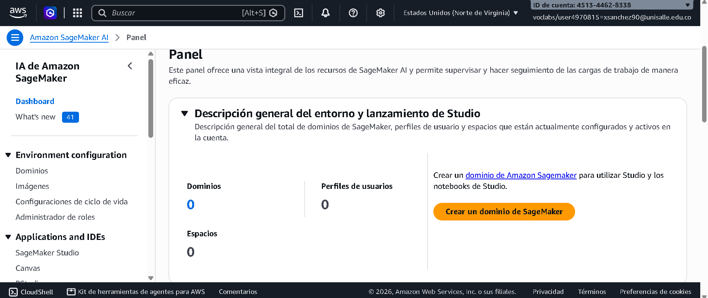
*Consola de Amazon SageMaker AI con la cuenta del laboratorio.*

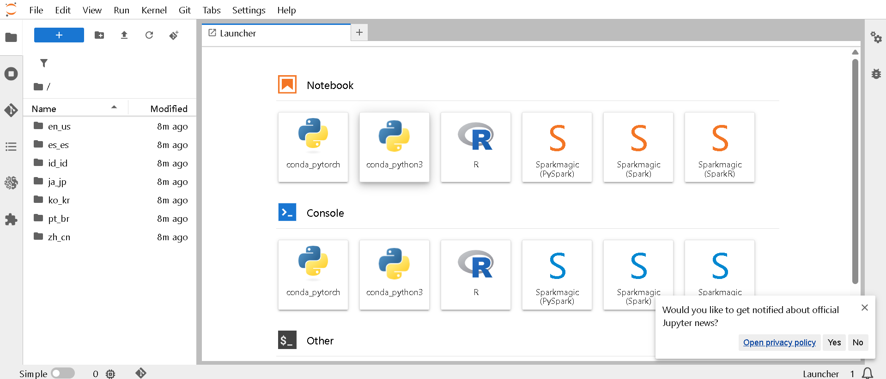
*JupyterLab abierto en la instancia de cuaderno, con las carpetas por idioma.*

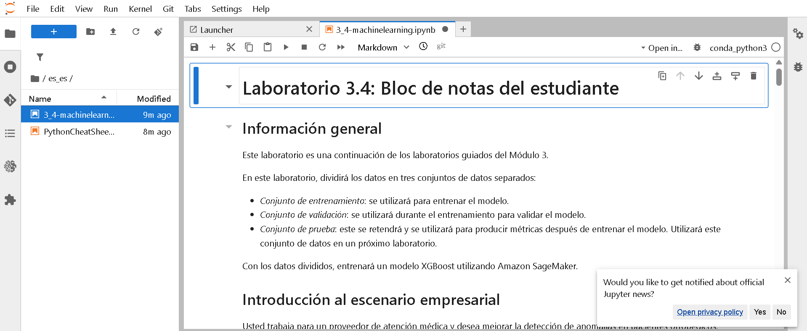
*Cuaderno del estudiante del laboratorio 3.4.*

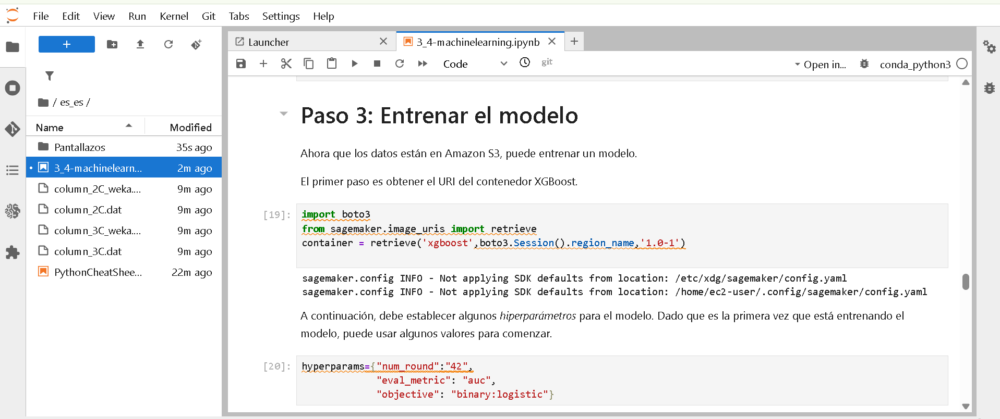
*Obtención del contenedor XGBoost y definición de hiperparámetros.*

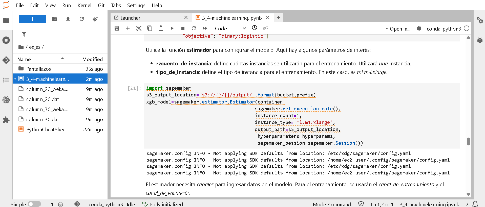
*Configuración del estimador: una instancia ml.m4.xlarge y salida en S3.*

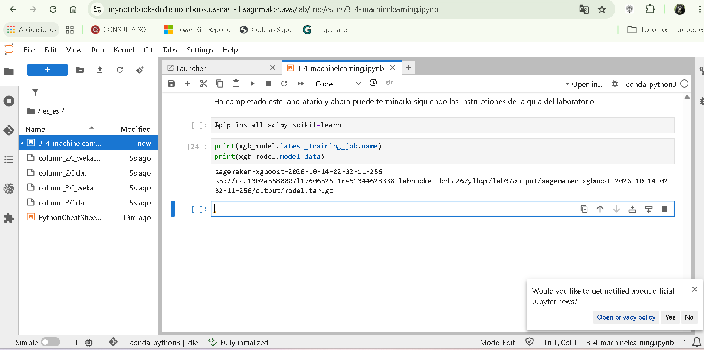
*Nombre del trabajo de entrenamiento y ubicación del `model.tar.gz` en S3.*

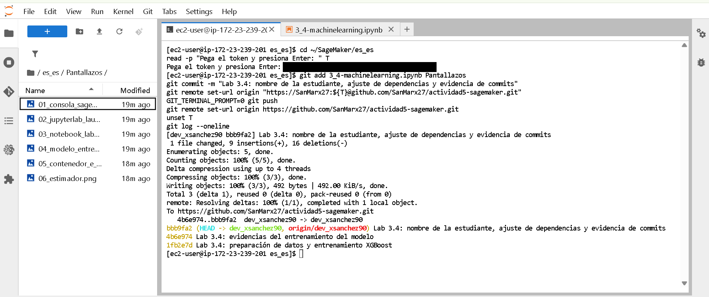
*Commits y `push` de la rama `dev_xsanchez90` desde la terminal de la instancia de AWS.*

---

## Laboratorio 3.5 — Implementación de un modelo

**Objetivos del laboratorio (según la guía):**

- Alojar (implementar) un modelo entrenado en un punto de enlace de SageMaker.
- Realizar predicciones con el modelo alojado.
- Eliminar el punto de enlace.
- Realizar una transformación por lotes sobre el conjunto de prueba.

### Paso 0 — Configuración del laboratorio

**Qué hice:** el laboratorio 3.5 abre un entorno nuevo, así que primero traje mi rama desde GitHub
(`git fetch` + `git checkout`) para seguir trabajando sobre los commits del 3.4. Luego ejecuté las celdas de
configuración, que repiten los pasos clave del 3.4: importación, mapeo de la clase, columna objetivo al inicio,
división 80/10/10, carga a S3 y entrenamiento. Volví a necesitar `%pip install scipy scikit-learn`.

**Resultado:** trabajo de entrenamiento `sagemaker-xgboost-2026-10-14-03-14-18-071`, terminado con el mensaje
`ready for hosting!`.

### Paso 1 — Alojar el modelo

**Qué hice:**

```python
xgb_predictor = xgb_model.deploy(initial_instance_count=1,
                                 serializer=sagemaker.serializers.CSVSerializer(),
                                 instance_type='ml.m4.xlarge')
```

**Por qué:** `deploy` crea tres recursos: el **modelo**, la **configuración del punto de enlace** y el **punto
de enlace**, que es un servicio HTTPS que responde predicciones en tiempo real. `initial_instance_count=1` y
`ml.m4.xlarge` definen la máquina que atiende las peticiones. El `CSVSerializer` permite enviarle una fila como
texto separado por comas, el mismo formato con el que se entrenó. Se creó el endpoint
`sagemaker-xgboost-2026-10-14-03-17-14-587`; los guiones y el `!` final indican que quedó en servicio.

### Paso 2 — Realizar predicciones

**Qué hice:** tomé la primera fila del conjunto de prueba sin la columna objetivo (`test.iloc[0:1, 1:]`), la
convertí a texto CSV y la envié con `xgb_predictor.predict(test_row)`.

**Por qué:** el endpoint recibe solo las seis características; la clase es lo que tiene que predecir.
`iloc[filas, columnas]` con `0:1` toma la primera fila y con `1:` descarta la columna 0 (`class`).

**Resultado:** `b'0.9966071844100952'`. Es una **probabilidad**, no un 0 o 1: el modelo estima 99.7 % de
probabilidad de que el paciente sea anormal. Al compararlo con `test.head(5)`, ese paciente (fila 136) es de
clase 1 (anormal), así que **la predicción es correcta**.

### Paso 3 — Eliminar el punto de enlace

**Qué hice:** `xgb_predictor.delete_endpoint(delete_endpoint_config=True)`.

**Por qué:** un punto de enlace cobra por cada hora que está encendido, aunque nadie lo use. Como para evaluar
todo el conjunto de prueba existe una forma más eficiente (la transformación por lotes), se elimina el endpoint
junto con su configuración.

### Paso 4 — Transformación por lotes

**Qué hice:**

1. Tomé todas las filas de prueba sin la columna objetivo (`test.iloc[:, 1:]`) y las subí a S3 como
   `batch-in/batch-in.csv`.
2. Creé un transformador con `xgb_model.transformer(...)`: una instancia `ml.m4.xlarge`,
   `strategy='MultiRecord'` (envía varias filas por petición), `assemble_with='Line'` (una predicción por línea)
   y salida en `batch-out/`.
3. Lancé `transform(..., content_type='text/csv', split_type='Line')` y esperé con `wait()`.
4. Descargué `batch-out/batch-in.csv.out` de S3 a un DataFrame y convertí cada probabilidad en 0/1 con la
   función `binary_convert`, que usa un **umbral de 0.65**.

**Por qué:** la transformación por lotes levanta la instancia, predice todo el archivo, escribe el resultado en
S3 y apaga la instancia sola. No queda nada encendido, a diferencia del endpoint. Es la forma adecuada de
evaluar un conjunto completo.

**Problema resuelto:** la celda que lee el resultado fallaba con
`TypeError: read_csv() takes 1 positional argument but 2 positional arguments...`, porque la versión actual de
pandas ya no acepta el separador como argumento posicional. Lo corregí escribiendo `sep=','`:

```python
target_predicted = pd.read_csv(io.BytesIO(obj['Body'].read()), sep=',', names=['class'])
```

**Resultado (primeras 10 filas de prueba):**

| Fila | Clase real | Probabilidad | Predicción (umbral 0.65) | ¿Acierta? |
|---|---|---|---|---|
| 136 | 1 | 0.996607 | 1 | Sí |
| 230 | 0 | 0.777283 | 1 | No |
| 134 | 1 | 0.994641 | 1 | Sí |
| 130 | 1 | 0.993690 | 1 | Sí |
| 47 | 1 | 0.939139 | 1 | Sí |
| 135 | 1 | 0.997396 | 1 | Sí |
| 100 | 1 | 0.991977 | 1 | Sí |
| 89 | 1 | 0.987518 | 1 | Sí |
| 297 | 0 | 0.993334 | 1 | No |
| 4 | 1 | 0.682776 | 1 | Sí |

De estas 10, el modelo acierta 8. Los dos errores son pacientes **normales clasificados como anormales**
(falsos positivos). Con un umbral más alto, por ejemplo 0.8, la fila 230 pasaría a predecirse como normal (y
acertaría), pero la fila 4 pasaría también a normal (y fallaría): el umbral cambia el equilibrio entre falsos
positivos y falsos negativos. Como dice la guía, este modelo inicial no está ajustado; sus métricas se calculan
en el laboratorio siguiente.

### Evidencia del laboratorio 3.5

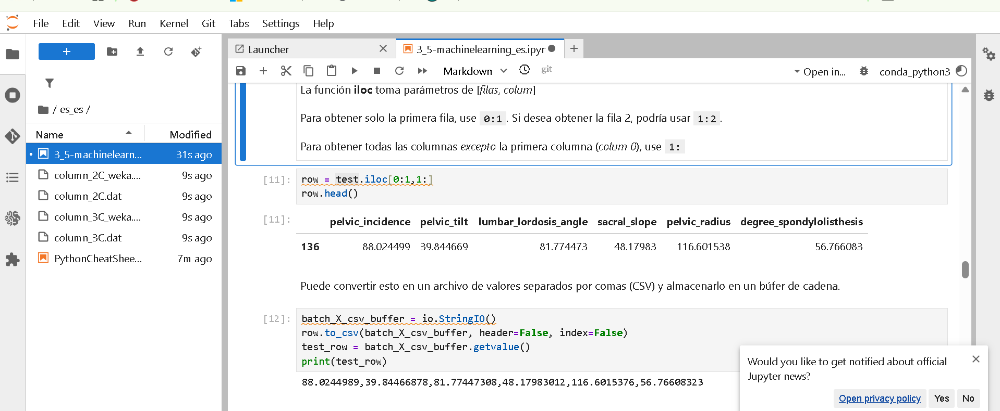
*Primera fila de prueba sin la columna objetivo, convertida a CSV para enviarla al endpoint.*

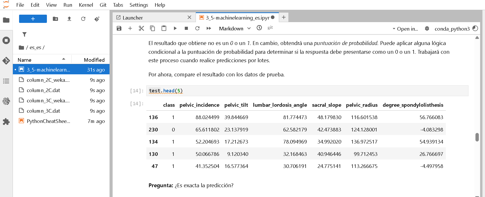
*Comparación con los datos de prueba: la fila 136 es de clase 1.*

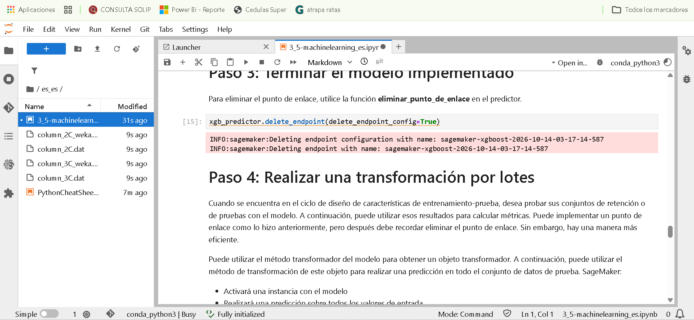
*Eliminación del punto de enlace y su configuración.*

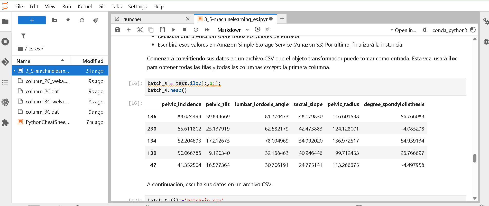
*Conjunto de prueba sin la columna objetivo, entrada de la transformación por lotes.*

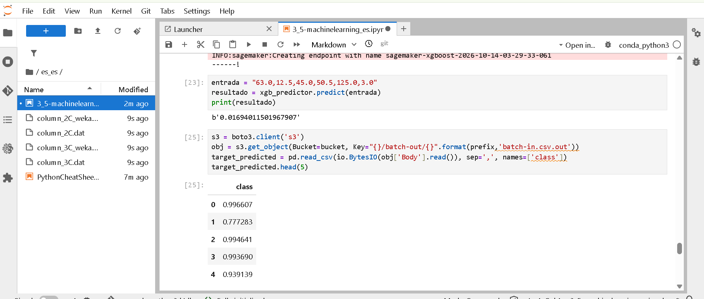
*Validación con la entrada de la actividad y probabilidades de la transformación por lotes.*

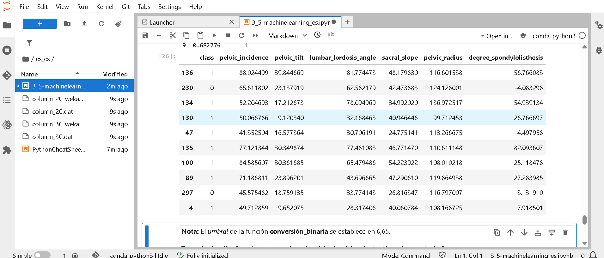
*Predicciones convertidas a 0/1 con umbral 0.65, comparadas con la clase real.*

---

## Validación de la actividad

Con el endpoint desplegado (`xgb_predictor`) envié la entrada pedida:

```python
entrada = "63.0,12.5,45.0,50.5,125.0,3.0"
resultado = xgb_predictor.predict(entrada)
print(resultado)
```

**Resultado:** `b'0.01694011501967907'`

Como el endpoint del paso 3 ya se había eliminado, volví a desplegarlo solo para esta prueba (endpoint
`sagemaker-xgboost-2026-10-14-03-29-33-061`) y lo eliminé apenas obtuve el resultado.

### ¿Qué lectura le doy al resultado?

| Característica | Valor enviado |
|---|---|
| Incidencia pélvica | 63.0 |
| Inclinación pélvica | 12.5 |
| Ángulo de lordosis lumbar | 45.0 |
| Inclinación del sacro | 50.5 |
| Radio pélvico | 125.0 |
| Grado de espondilolistesis | 3.0 |

- El valor es la **probabilidad de que el paciente sea anormal** (clase 1), porque así se codificó la etiqueta y
  porque el objetivo es `binary:logistic`. Es **0.0169, es decir 1.7 %**.
- Está muy por debajo del umbral del laboratorio (0.65) y también del umbral habitual de 0.5, así que el modelo
  clasifica al paciente como **Normal (clase 0)**, con una confianza alta: 98.3 % de probabilidad de ser normal.
- La lectura es coherente con los datos:
  - El **grado de espondilolistesis (3.0) es bajo**. En el conjunto de prueba, la mayoría de los pacientes
    anormales tiene valores altos (entre 25 y 82), mientras que los normales están cerca de 0 (−4.1 y 3.1).
  - El **radio pélvico (125.0)** está en el rango de los normales: la fila 230, normal, tiene 124.1.
  - Los valores son consistentes entre sí: inclinación pélvica + inclinación del sacro = 12.5 + 50.5 = 63.0, que
    es la incidencia pélvica.
  - Aun así, ninguna característica decide sola: el modelo combina las seis. Por ejemplo, la fila 297 (normal,
    espondilolistesis 3.1) recibió 0.993 en la transformación por lotes, y las filas 47 y 4 son anormales con
    espondilolistesis baja (−4.5 y 7.9).
- Hay que tomarlo como un **apoyo a la decisión, no un diagnóstico**. El modelo se entrenó con 248 pacientes,
  sin ajuste de hiperparámetros, y la transformación por lotes mostró que se equivoca con algunos normales.

---

## Repositorio y rama

- **URL:** https://github.com/SanMarx27/actividad5-sagemaker/tree/dev_xsanchez90
- **Rama:** `dev_xsanchez90` (`dev_` + usuario del correo institucional `xsanchez90@unisalle.edu.co`)
- **Cómo se trabajó:** todos los commits se hicieron desde la terminal de JupyterLab de las instancias de AWS
  (`~/SageMaker/es_es`). Los pantallazos se cargaron a la carpeta `Pantallazos` con el botón de carga de
  Jupyter, no por fuera del repositorio.

| Commit | Laboratorio | Descripción |
|---|---|---|
| `1fb2e7d` | 3.4 | Preparación de datos y entrenamiento XGBoost |
| `4b6e974` | 3.4 | Evidencias del entrenamiento del modelo |
| `bbb9fa2` | 3.4 | Nombre de la estudiante, ajuste de dependencias y evidencia de commits |
| `1fac217` | 3.4 | Nombre en Markdown y pantallazo de commits |
| `c5cb34d` | 3.5 | Despliegue del endpoint, predicción y validación con la entrada pedida |
| `c91b16b` | 3.5 | Evidencias de predicción y eliminación del endpoint |
| `89fa078` | 3.5 | Evidencias de transformación por lotes y validación |

El commit `c5cb34d` aparece con autor *EC2 Default User*: es la identidad por defecto de la instancia de AWS del
laboratorio 3.5, que todavía no tenía configurado `user.name`. Después lo configuré y los siguientes commits
salen a mi nombre.

### Problemas resueltos con Git

- **Repositorio creado en la carpeta equivocada:** el primer `git init` quedó en la carpeta personal de la
  instancia (y otro en la copia en chino del laboratorio, `zh_cn`) en lugar de `es_es`. Borré esos repositorios
  sin subir nada y lo creé en `~/SageMaker/es_es`.
- **Autenticación:** GitHub no acepta la contraseña de la cuenta para `git push`; se usa un *Personal Access
  Token* con permiso `repo`. Lo ingresé con `read` en la terminal y lo quité de la configuración del remoto
  después de cada `push`, para que no quede guardado en la instancia ni aparezca en los pantallazos.
- **Entorno nuevo en el 3.5:** como cada laboratorio es una máquina distinta, traje la rama con
  `git fetch origin dev_xsanchez90` y `git checkout -b dev_xsanchez90 origin/dev_xsanchez90` para que los commits
  del 3.5 quedaran encima de los del 3.4, sin reescribir la historia.

---

## Conclusión

Se cumplieron los objetivos de las dos guías. En el laboratorio 3.4 se prepararon los datos para el formato que
exige el XGBoost integrado de SageMaker (etiqueta en la primera columna, CSV sin encabezados), se dividieron en
entrenamiento, validación y prueba de forma estratificada, se cargaron a S3 y se entrenó el modelo con un trabajo
de entrenamiento administrado. En el laboratorio 3.5 ese modelo se alojó en un punto de enlace, se usó para
predecir en tiempo real, se eliminó el endpoint para no generar costos y se evaluó el conjunto de prueba
completo con una transformación por lotes.

La validación con la entrada `63.0,12.5,45.0,50.5,125.0,3.0` dio una probabilidad de 0.0169 de anomalía, por lo
que el paciente se clasifica como **normal**. El aprendizaje principal fue entender la diferencia entre las dos
formas de usar un modelo en SageMaker: el **endpoint** sirve para predicciones en línea, pero cobra mientras
está encendido; la **transformación por lotes** sirve para evaluar muchos registros y se apaga sola. También
quedó claro que la salida del modelo es una probabilidad, y que el umbral para convertirla en 0/1 es una
decisión que cambia el balance entre falsos positivos y falsos negativos.
